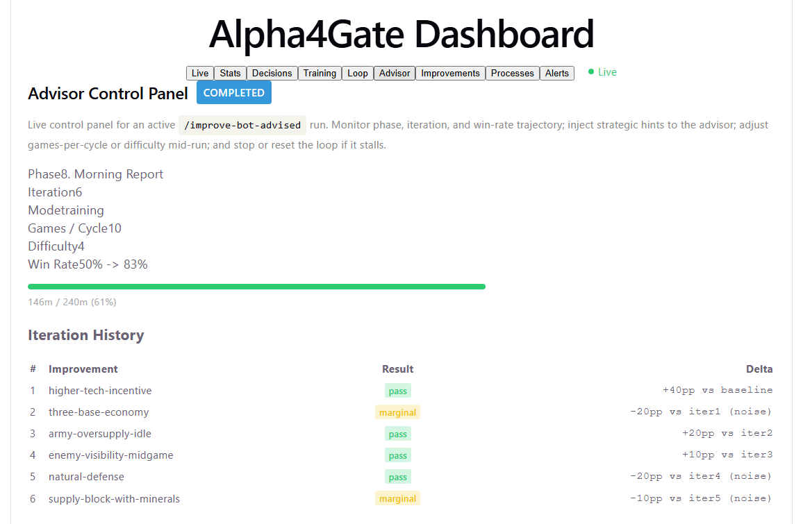
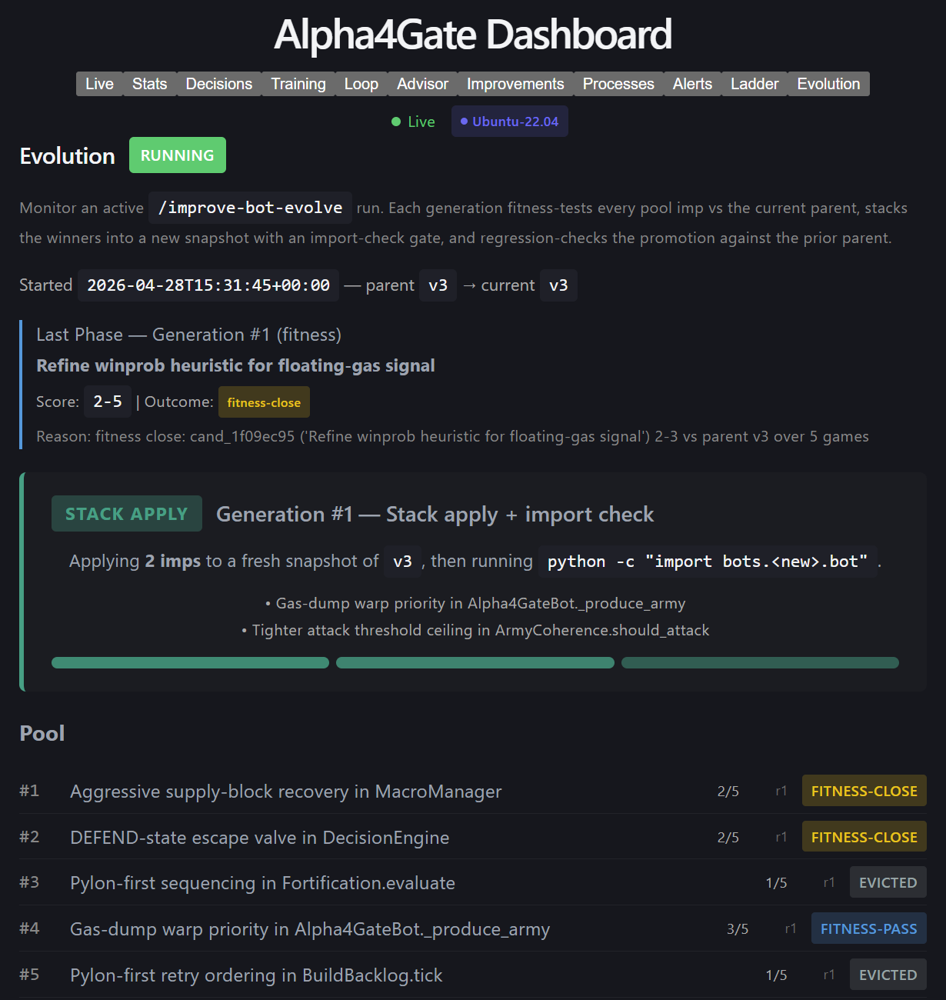
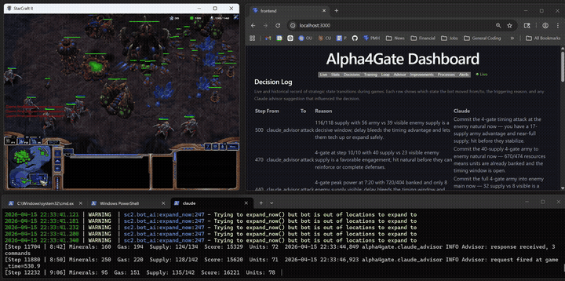
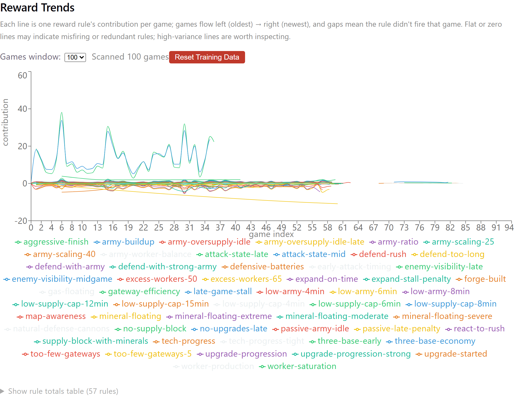
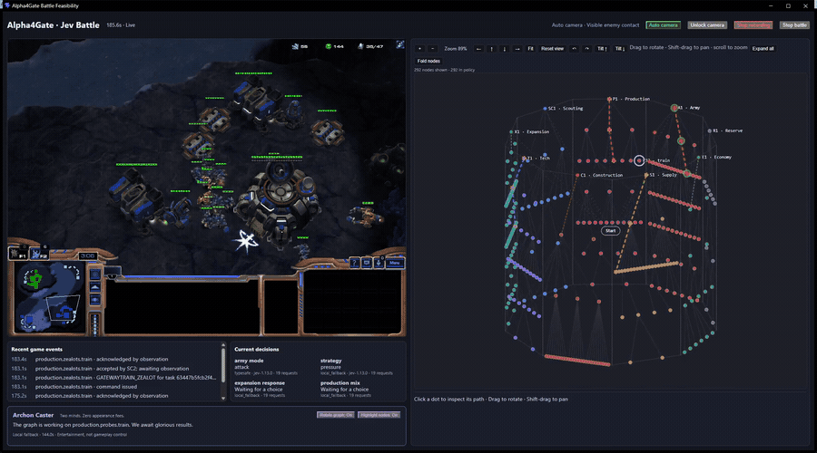
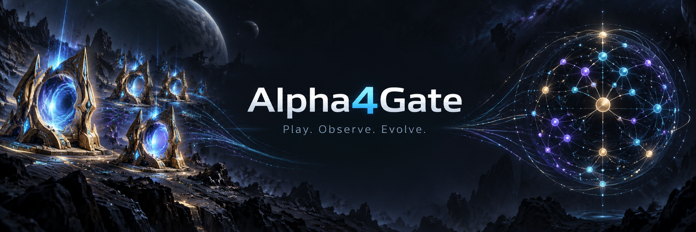

# Alpha4Gate

 [](https://github.com/aberson/Alpha4Gate/actions/workflows/linux-tests.yml) 

An AI lab that started with a simple goal: beat a friend at StarCraft II.

Alpha4Gate plays games, diagnoses failures, proposes code changes, and tests
candidates against opponents. A live React dashboard makes those experiments
visible. Alongside the evolving rule-based/PPO bot, **Jev** explores a different
approach: a hosted Typesafe model makes choices during the match, and a local
decision graph carries them out.

**Two complementary learning loops:**

- **Advised loop:** signal comes from playing an external static opponent (Blizzard's stock SC2 AI). Claude reads the bot-vs-stock games and proposes fixes. Improvement is measured against a fixed bar that never moves.
- **Evolve loop:** signal comes from self-play between our own bot versions. Candidates compete with their ancestors; optional frozen baselines provide another reference point.

Advised measures progress against a known opponent; evolve tests progress against
the bot's own lineage. Both improve the versioned bot between games.

**A new player alongside those loops — Jev:** Typesafe's hosted Jev model chooses
among available strategy and execution options *during* a game. Its graph maintains
plans, checks resources and legality, and issues SC2 commands while requests are
pending. This is a separate player family, with no PPO. Connecting it to automated
between-game evolution is future work.

<table>
<tr>
<td width="25%" valign="top" align="center">
<a href="documentation/images/advisor-completed.png"></a>
<br/><sub><b>Self-improvement loop</b><br/>6 fixes proposed, validated, committed</sub>
</td>
<td width="25%" valign="top" align="center">
<a href="documentation/images/evolution-running.png"></a>
<br/><sub><b>Self-play arena</b><br/>Live evolve run — fitness pool, stack apply, regression</sub>
</td>
<td width="25%" valign="top" align="center">
<a href="documentation/images/sc2-gameplay.gif"></a>
<br/><sub><b>Live capture</b><br/>Game, advisor decisions, and backend logs streaming together</sub>
</td>
<td width="25%" valign="top" align="center">
<a href="documentation/images/reward-trends.png"></a>
<br/><sub><b>Monitoring</b><br/>Per-rule reward contribution over recent games</sub>
</td>
</tr>
<tr>
<td colspan="4" align="center">
<a href="documentation/media/jev-battle-view.mp4"></a>
<br/><sub><b>Jev Battle View</b><br/>The match and its decisions, together — click for the 40-second video</sub>
</td>
</tr>
</table>

> **Historical results, not a current Jev benchmark:** the April 17 advised-run
> report recorded **68/82 wins (83%)** at difficulty 4 over the preceding week.
> An eight-hour headless Linux evolve run promoted **v4 → v7**. The versioned
> lineage later reached **v13**. [Advised report](documentation/soak-test-runs/advised-2026-04-17.md) · [Evolve report](documentation/soak-test-runs/evolve-2026-04-30T20-15-20+00-00.md)

## What makes this different

The project combines automated improvement with an inspectable playing experience:

- **Claude reads telemetry like a reviewer** — names the specific failure ("attacked before the economy caught up"), not just a scalar reward. Ranked fixes with reasoning.
- **Proposals become real code.** The improvement loops produce `[advised-auto]` or `[evo-auto]` commits, with pytest, mypy and ruff gates around candidate changes.
- **Games test the changes.** Advised validates fixes across a game batch. Evolve evaluates candidates, then checks the combined promotion against its parent and reverts it if the configured regression gate fails. Finite samples can still miss regressions.
- **You can watch it happen.** The dashboard streams every phase — proposals, rejections, win-rate swings, generation outcomes — live while the agent runs unattended for hours.

SC2 supplies concrete outcomes and a demanding test of planning, execution and observation. The improvement-loop pattern may transfer elsewhere; this implementation remains SC2-specific.

**Deep dives:** [Wiki](documentation/wiki/index.md) · [Active plan](https://github.com/aberson/Alpha4Gate/blob/master-plan/phase-ev/documentation/master_plan.md)

---

## The autonomous learning loop

```
                    ┌──────────────────────────────────────────────────────┐
                    │          /improve-bot-advised                        │
                    │       autonomous learning loop (4+ hours)            │
                    │                                                      │
  ┌─────────┐       │   ┌─────────┐    ┌─────────┐    ┌─────────┐          │
  │         │       │   │         │    │         │    │         │          │
  │   THE   │◄─────────►│  PLAY   │───►│  THINK  │───►│  FIX    │          │
  │   TASK  │       │   │         │    │         │    │         │          │
  │         │       │   └─────────┘    └─────────┘    └────┬────┘          │
  │ (SC2)   │◄──┐   │                                      │               │
  │         │   │   │   ┌─────────┐    ┌─────────┐    ┌────▼────┐          │
  │         │   └──────►│  TRAIN  │◄───│ COMMIT  │◄───│  TEST   │          │
  │         │       │   │         │    │         │    │         │          │
  └─────────┘       │   └─────────┘    └─────────┘    └─────────┘          │
                    │         │                                            │
                    │         └──────── loop back to PLAY ──────────────►  │
                    │                   (or stop if time's up / 3 fails)   │
                    └──────────────────────────────────────────────────────┘
```

The loop runs unattended for hours. Each cycle: play N games, Claude reads the results and proposes ranked fixes, apply one, re-run N games to validate, commit if it held, retrain the neural policy, repeat. Quality gates (pytest/mypy/ruff), auto-rollback, a wall-clock budget, and a 3-fail cap keep it safe.

**Read the full architecture:** [improve-bot-advised-architecture.md](documentation/wiki/improve-bot-advised-architecture.md)

---

## The self-play arena

A different kind of loop from the advised one — instead of validating one improvement at a time, the arena generates a pool of orthogonal candidates per generation and lets them compete. The bot grows by ancestor chain — v0 → v1 → v2 → … — and each link is one pass through this loop:

<picture>
  <source media="(prefers-color-scheme: dark)" srcset="documentation/images/evolve-arena-dark.svg">
  
</picture>

What the diagram can't show: **stack-apply is a re-write, not a merge** — each fitness winner is re-implemented from its text description by a fresh sub-agent onto the new snapshot, in rank order, with a 30-second import check catching bad combinations; and **promotion commits before the regression gate** — the `[evo-auto]` commit lands first, and a regression loss (or a sweep loss against the frozen baseline panel, when armed) triggers a real `git revert`. Each promotion is a versioned commit; each regression rollback is a revert. Close-losers retry against the next parent; evicted imps get replaced at the generation-end pool refresh.

**Read the mechanism:** [improve-bot-evolve SKILL.md](.claude/skills/improve-bot-evolve/SKILL.md) · [gate-reduction plan](documentation/archived/evolve-gate-reduction-plan.md)

---

## The Jev adventure: from four Gateways to a live decision graph



*Conceptual project artwork; the animated panel above and video below show the actual UI.*

Jev began with one deliberately modest plan: a Zealot rush, with **four Gateways**
in honor of the project name. That became the frozen `v1.jev` player. The first
local graph proved the player and viewer worked; it did not call Typesafe. We then
connected the actual hosted model and made its decisions visible beside local
fallbacks. The model version (`jev-1.13.0`) and our player version (`v2.jev`) name
different things.

The v2 graph now has nine branches: economy, supply, construction, tech, expansion,
scouting, production, army and reserve. It adds a Probe scout, gas, a Cybernetics
Core, a natural-expansion plan, and a Zealot/Stalker army. The model answers four
kinds of question: strategy, army mode, expansion response and production mix.
Those choices affect both strategic direction and how existing plans proceed.

The graph evaluates live game facts, reserves resources, tracks ongoing tasks,
and checks whether commands actually took effect. Hosted requests are asynchronous;
economy and other independent branches keep running while an answer is pending.
Unavailable, invalid or stale answers have explicit fallback behavior, and the
trace records the decision source. The 3D graph shows this recorded policy activity;
it is not a picture of the model's internal thoughts.

One revealing test left a large army gathering at home: an `attack` choice was
being overridden by a repeatedly renewed `recover` posture. Seeing both choices
made the conflict diagnosable. Resolving that recovery lifecycle and completing
the v2 gameplay acceptance runs remain open work. A richer graph and a working
API connection do not, by themselves, establish a stronger player.

**Explore:** [Jev code](https://github.com/aberson/Alpha4Gate/tree/master-plan/phase-ev/src/jev) · [v2 policy](https://github.com/aberson/Alpha4Gate/blob/master-plan/phase-ev/bots/jev/v2/policy.json) · [Recovery investigation](https://github.com/aberson/Alpha4Gate/blob/master-plan/phase-ev/documentation/investigations/jev-recovery-stall-2026-10-11.md)

## Watching Jev play: Battle View and Archon Caster

**[Watch the 40-second Battle View video](documentation/media/jev-battle-view.mp4)** ·
[Open the video directly](https://raw.githubusercontent.com/aberson/Alpha4Gate/master/documentation/media/jev-battle-view.mp4) ·
[Recording details](documentation/media/README.md)

Battle View brings native SC2 and the decision graph into one Windows window.
The graph occupies the right half; decisions, recent events and commentary sit
beside the game. An automatic observer follows visible action, or you can unlock
the camera and move it yourself. The dashboard's Jev tab also supports selectable
branches, compact nodes, radial layouts and several 3D arrangements. Larger active
dots, labeled branch roots and a full-path inspector make busy graphs easier to read.

**Archon Caster** supplies short game commentary, random AI facts and dad jokes in
a 70/15/15 mix. It uses local Qwen through Ollama, with labeled fallback text when
generation is unavailable or slow. Commentary can highlight its subject with a
purple halo, and the graph can slowly rotate; both have independent switches.
The caster observes the match and never issues gameplay orders.
*Two minds. Zero appearance fees.*

**Record Battle** captures the combined view with game audio only. You can start
it mid-match or record automatically on launch; recordings stay with the run ID,
replay and decision trace. Desktop matches have no game-time or wall-clock cap,
but the default **450 paid Typesafe requests** still applies. Once exhausted,
the graph continues with local fallback decisions. The local caster has no paid
API calls; the hosted player uses Typesafe credits.

**Try the preview:** Jev and Battle View currently live on
[`master-plan/phase-ev`](https://github.com/aberson/Alpha4Gate/tree/master-plan/phase-ev),
not in the default branch's runtime. Use that checkout and follow the
[Battle View setup guide](https://github.com/aberson/Alpha4Gate/blob/master-plan/phase-ev/documentation/operator/jev-battle-view.md), then run:

```powershell
powershell -File scripts/launch-jev-battle.ps1 -AutoRecord
```

This Windows preview requires SC2, a Typesafe key and credits, and the documented
isolated OBS setup. The development workstation has two desktop shortcuts; they
are not installed automatically by cloning the repo. The video is an interrupted
demonstration, not a completed-match result or a win-rate benchmark.

---

## How we watch it run

```
      autonomous learning loop                  StarCraft II game
      ─────────────────────────                  ─────────────────
      PLAY → THINK → FIX →                       (THE TASK)
      TEST → COMMIT → TRAIN
               ▲                                        ▲
               │                                        │
        observe the loop                         observe the game
               │                                        │
      ┌────────┴────────┐                      ┌────────┴────────┐
      │ Advisor tab     │                      │ JSONL logs      │
      │ Evolution tab   │                      │ SC2 client      │
      │ state.json      │                      │ replays/        │
      └─────────────────┘                      └─────────────────┘
```

Two things are running: the **loop** and the **task** it's learning from. The dashboard has a tab tuned to each vantage point, plus a state file that's the single source of truth for which phase is executing right now. Stuck-loop detection, alert rules, and operator overrides all hang off these views.

For the advised loop that's the **Advisor tab** + `data/advised_run_state.json`; for evolve it's the **Evolution tab** + `data/evolve_run_state.json` (plus `data/evolve_pool.json` for the current pool and `data/evolve_results.jsonl` for per-phase outcomes). Same pattern, different loop. Jev adds a third vantage point: per-run policy, decisions and events in the Jev tab, with the combined Battle View for watching a live match.

**Read the full monitoring guide:** [monitoring.md](documentation/wiki/monitoring.md)

---

## Why not just have Claude do everything?

Real-time play needs predictable local execution while remote model requests
take time to return. In the original player family, rules and an optional PPO
policy handle gameplay; Claude supplies asynchronous advice and writes improvements
between batches.

Jev takes a different split: the hosted Typesafe model makes constrained choices
during the match, while the local graph continues executing tasks and checking
live facts. We run hosted demonstrations in real time because faster simulation
can outrun reply freshness. Neither player waits for a general-purpose coding
assistant to issue every unit command.

---

# The Story So Far of Alpha4Gate

- **Original Motivation -** Beat my friend at a video game using AI.
- **The basic bot -** A rule-based bot player that built units and hoped for the best. 
- **Teaching it to think -** Added a neural network so it could learn.
- **Learning to fight -** Targeted lessons: keep the army together, deny expansions, hold the line.
- **Bringing in a coach -** Claude whispers strategy tips mid-match alongside human commands.
- **The observation deck -** A live dashboard showing every decision, reward, and training run.
- **The robot that trains itself -** A daemon that plays, scores, promotes winners, and rolls back duds overnight.
- **The first soak test -** Left it alone — 17 things broke. Fixed them all.
- **Claude as personal trainer -** Claude watches games, diagnoses problems, and writes the fixes itself.
- **The breakthrough -** Self-improvement took win rate from 0% to 75% at difficulty 3.
- **Reality check -** Harder opponents exposed that training scores lie — need honest exams.
- **The big merge -** Three plans became one: every future bot is a snapshot that must beat its ancestors.
- **Memory matters -** Added memory (LSTM) and a gentler training recipe — 19/20 wins at difficulty 3.
- **The arena -** Bot versions fight each other in sandboxed self-play. Elo ladder + promotion gate decides who ships.
- **Overnight run, zero promotions -** Three compound 60% filters made the math impossible, dropped the redundant composition check.
- **The arena produces winners -** 7 hours, v0 → v1 → v2 — the self-play loop ships its first two auto-promotions.
- **Headless training substrate -** Moved the heavy training off Windows onto a headless Linux runtime (massive speed increase)
- **Three promotions in one night, on Linux -** First end-to-end successful headless evolve. v4 → v5 → v6 → v7 in one 8-hour unattended soak 
- **Parallelizing the arena -** Evolve now runs four candidates in parallel per generation (concurrency window + worker-slot recycling). Steps 1-7 plus iter-3 hardening shipped 2026-04-30; subsequent generations took the lineage to **v10**.
- **A second player -** A four-Gateway Zealot rush became Jev v1, then a hosted Typesafe integration and an adaptive v2 graph with scouting, expansion and mixed armies.
- **Making decisions visible -** Branch cards grew into compact and radial layouts, then 3D views with a starting hub, branch labels and inspectable paths.
- **A seat at the match -** Battle View combines SC2, the graph, a camera observer, recording and a local Archon Caster. The real hosted demo is linked above.
- **Now (2026-10-11) -** The versioned lineage is at v13. Jev v2 and Battle View are implemented on the preview branch; formal gameplay acceptance remains open. They are separate player families, and Jev is not yet part of the evolution loop.
- **Next -** Address Jev's recovery/attack conflict, complete bounded live acceptance, and measure future decision-choice flattening against a preserved before/after baseline. The frozen-v1 benchmark remains deferred. On the evolution side, EH.1–EH.2 hardening is shipped; EH.3–EH.10 and the EV operator acceptance gates remain pending. [Current plan](https://github.com/aberson/Alpha4Gate/blob/master-plan/phase-ev/documentation/master_plan.md).

---

<details>


<summary><b>Stack</b></summary>

| Layer | Tool | Why |
|---|---|---|
| Language | Python 3.12+ | SC2 libraries are Python-native |
| SC2 interface | burnysc2 | Async BotAI; dependency versions recorded in uv.lock |
| AI advisor | Claude CLI (OAuth or API key) | Strategic advice mid-game, async subprocess |
| Build orders | Spawning Tool API | Community build order database |
| Backend | FastAPI | WebSocket + REST for dashboard |
| Frontend | React + TypeScript + Vite | Live dashboard with game state streaming |
| Deep learning | PyTorch + Stable Baselines 3 | PPO policy network for strategic decisions |
| Jev gameplay | Hosted Typesafe + local graph | Constrained in-game choices and persistent task execution; no PPO |
| Battle View | Native SC2 + React + OBS (Windows) | Combined viewing and recording preview |
| Archon Caster | Ollama + Qwen 2.5 1.5B | Local text commentary; no gameplay control |
| Training data | SQLite | Structured (s,a,r,s') transition storage |
| Testing (Python) | pytest | Unit tests plus separately marked SC2, Windows and browser checks |
| Testing (Frontend) | vitest + jsdom + @testing-library/react | Component, hook and graph behavior tests |
| Linting | ruff + mypy | Strict type checking, consistent style |

</details>

<details>

<summary><b>Setup</b></summary>

### Prerequisites

- Windows 11 (primary dev). Linux / WSL2 also supported for the headless training substrate — see [documentation/wiki/cloud-deployment.md](documentation/wiki/cloud-deployment.md) and [documentation/wiki/linux-dev-environment.md](documentation/wiki/linux-dev-environment.md).
- StarCraft II installed at `C:\Program Files (x86)\StarCraft II\` (Windows) or `~/StarCraftII/` (Linux/WSL).
- Python 3.12+
- [uv](https://docs.astral.sh/uv/) package manager
- Node.js 22.12+ (for the current React/Vite frontend)
- SC2 maps from [Blizzard CDN](https://blzdistsc2-a.akamaihd.net/MapPacks/Melee.zip) (password: `iagreetotheeula`) — do NOT use GitHub map files (Git LFS pointers)

### Install

For the Jev features described here, first check out `master-plan/phase-ev`; the
default branch does not yet include that runtime. See the linked operator guides
for Typesafe credentials and Battle View prerequisites.

1. Install Python dependencies:
   ```bash
   cd Alpha4Gate
   uv sync
   ```

2. Create `.env` from template and fill in your keys:
   ```bash
   cp .env.example .env
   # Edit .env: set SC2PATH, SPAWNING_TOOL_API_KEY
   # Claude advisor auth: claude CLI must be on PATH with OAuth token or API key
   ```

3. Install frontend dependencies:
   ```bash
   cd frontend && npm install && cd ..
   ```

### Dashboard

```bash
# One-shot: start backend + frontend together (Git Bash)
bash scripts/start-dev.sh

# Or in two terminals:
# Terminal 1: backend
uv run python -m bots.current.runner --serve

# Terminal 2: frontend dev server
cd frontend && npm run dev
# Opens http://localhost:3000 proxying to :8765
```

</details>

<details>
<summary><b>Dashboard tabs</b></summary>

| Tab | Purpose |
|---|---|
| Advisor | Live advised-run status, loop controls, strategic hints, reward injection |
| Evolution | Live `improve-bot-evolve` run — fitness pool, stack apply, regression, generation outcomes |
| Models | Per-version view: Lineage (absorbs the old Improvements timeline), Live Runs, Inspector, Compare and Forensics sub-views |
| Observable | Exhibition shell for Phase L: left/right version pickers and a placeholder card (replay-stream-as-live not shipped) |
| Processes | Live system process monitor, resource gauge, WSL processes, port status, state files, backend restart, plus the severity-filtered alert list (ack/dismiss) the old Alerts tab held |
| Help | Renders `documentation/wiki/operator-commands.md` from disk |
| Jev | Archived/live run selector; independently toggled branch cards with Add all/Collapse all; compact Nodes or Boxes, Tree/Radial layouts and Dots 3D shapes; Start hub and labeled branch roots; full-width graph with inspector below or optional overlay; recorded activity, plan and decision sources. `?tab=jev&run=<run_id>` opens an exact run; `?tab=jev&launch=<session_id>` follows a dashboard-first launch. Standalone Windows Battle View at `?battle=1` combines native SC2 and the graph through the local launcher. |

In-app `AlertToast` lives at the App root and shows new alerts as they fire, regardless of which tab is active.

</details>

<details>
<summary><b>Usage</b></summary>

### Run a game

```bash
# Single game vs Easy AI
uv run python -m bots.v0.runner --map Simple64

# Options
--difficulty 3       # AI difficulty 1-10 (default: Easy)
--realtime           # Watch in realtime
--batch 5            # Run 5 games, aggregate stats
--build-order 4gate  # Select build order (default: 4gate)
--serve              # Start dashboard API server only
--no-claude          # Disable Claude advisor
```

### Run the Jev player

Use the `master-plan/phase-ev` checkout for these commands.

**Combined Battle View preview (Windows):** watch hosted Typesafe Jev with the live 3D graph,
decision text and event log in one window. Run
`powershell -File scripts/launch-jev-battle.ps1`; add `-AutoRecord` for automatic
2160×1200 recording with game audio only. Desktop shortcuts are installed on the
development workstation. [Try it yourself](https://github.com/aberson/Alpha4Gate/blob/master-plan/phase-ev/documentation/operator/jev-battle-view.md).
This preview uses your saved Typesafe key and credits, requires the isolated portable OBS
setup, and does not complete the v2 gameplay acceptance gates.

Jev is a separate player family executed by a decision graph (interpreted by `src/jev/`); there is no PPO in it. `v1.jev` (`bots/jev/v1/policy.json`, frozen) is a one-base, four-Gateway Zealot rush. `v2.jev` (`bots/jev/v2/policy.json`, Jev v2 Steps 214-221) is the adaptive player: nine lanes (economy, supply, construction, tech, expansion, scouting, production, army, reserve) with planned supply, grouped reinforcements, one Probe scout, a gas economy, persistent tech (Cybernetics Core) and natural-expansion plans, and a Zealot/Stalker army. The default `scripted` provider runs locally. Opt into the actual hosted Typesafe Jev model with `--decision-provider typesafe`: for v1 it chooses attack, defend or regroup; for v2 four question families (`strategy`, `army_mode`, `expansion_response`, `production_mix`) share one request budget and choose among the graph's own branches, while the graph keeps every legal command. Each match writes evidence to `data/jev/runs/<run_id>/`, served by the dashboard's Jev tab (`/?tab=jev`, or `/?tab=jev&run=<run_id>` for one exact run) and the `/api/jev` routes: read-only run evidence, plus the loopback launch-readiness receipt that the dashboard-first launcher uses.

From the repository root, in PowerShell. Terminal 1, the dashboard backend (it keeps running):

```powershell
uv run python -m bots.current.runner --serve
```

Terminal 2, the frontend; then open <http://localhost:3000/?tab=jev>:

```powershell
cd frontend
npm run dev
```

Terminal 3, validate the policy, play one match, then verify that run:

```powershell
uv run python -m bots.jev.v1 --validate-policy      # validate the packaged policy, print its hash (no SC2)
uv run python -m bots.jev.v2 --validate-policy      # the same for the v2 package
uv run python -m bots.jev.v1 --map Simple64 --opponent-race Terran --difficulty 1 --seed 1 --max-game-seconds 900 --max-wall-seconds 1800
$runId = (Get-ChildItem data\jev\runs -Directory | Sort-Object CreationTime | Select-Object -Last 1).Name  # the newest run's ID
uv run python scripts\validate_jev.py --run-id $runId --api-base http://localhost:8765   # verify it: disk vs API
```

For actual Typesafe gameplay, configure `TYPESAFE_API_KEY` in terminal 3 and run:

```powershell
uv run python -m bots.jev.v2 --decision-provider typesafe --decision-model jev-1.13.0 --decision-max-requests 450 --realtime
```

The dashboard's **Army decision** panel identifies Typesafe decisions and scripted fallback, actual returned model, latency and token usage; for v2 the **Plans and decisions** panel and the graph's node sources show which request, fallback or local decision drove each plan and node. Missing credentials fail before SC2 starts. Setup and the separate live integration gate: [Typesafe validation](https://github.com/aberson/Alpha4Gate/blob/master-plan/phase-ev/documentation/operator/jev-validation.md#13-typesafe-jev-integration-phase-ji).

For an attended test, use the dashboard-first launcher. It starts or reuses the dashboard, opens the Jev tab on the exact run (`/?tab=jev&launch=<session_id>`), and starts SC2 only after that page has rendered the run and acknowledged it:

```powershell
powershell -File scripts/launch-jev.ps1 -Version v2 -DecisionProvider scripted -Difficulty 1 -Seed 1
```

Its defaults are `-Version v2 -DecisionProvider typesafe -Difficulty 3 -Seed 11`: with no arguments it plays `bots.jev.v2` as a paid hosted match (`-Version v1` plays v1). The v2 player, its lanes, plans and questions, the live graph and the Step 222 prerequisites are in section 13 of the [Jev v2 validation guide](https://github.com/aberson/Alpha4Gate/blob/master-plan/phase-ev/documentation/operator/jev-v2-validation.md#13-the-v2-player-and-the-live-graph-steps-214-221). The launcher and the reproducible benchmark are documented in the [Jev v2 validation guide](https://github.com/aberson/Alpha4Gate/blob/master-plan/phase-ev/documentation/operator/jev-v2-validation.md); for example, `uv run python scripts/benchmark_jev.py --panel baseline --dry-run` resolves the exact plan with no service call, SC2 launch or file write.

Stop a match with Ctrl+C once in its own terminal (the bot leaves cleanly; never kill SC2 processes wholesale). Full smoke and acceptance procedure: [documentation/operator/jev-validation.md](https://github.com/aberson/Alpha4Gate/blob/master-plan/phase-ev/documentation/operator/jev-validation.md).

### Running without Claude

For the versioned bot, the Claude advisor is optional. Pass `--no-claude` (or simply don't install the `claude` CLI) and the bot runs entirely on its rule-based strategy + optional PPO policy. Skip step 2's Claude-auth note during setup.

What still works without Claude:

| Feature | Notes |
|---|---|
| Rule-based play vs SC2 AI | `uv run python -m bots.v0.runner --no-claude --difficulty 3` |
| Batch runs + stats aggregation | `--batch 10 --no-claude` |
| Neural (PPO) play and training | Rule-based or hybrid decision mode; training loop is Claude-free |
| Dashboard — Evolution, Models, Observable, Processes, Help, Jev | All non-Advisor tabs render and update as normal |
| Daemon loop (auto-training, promotion, rollback) | Does not call Claude |

What needs Claude:

- Claude-generated advice and the `/improve-bot-advised` and `/improve-bot-evolve` improvement loops
- **Mid-game strategic advice** — the bot's `claude_advisor.py` subprocess (visible in JSONL game logs and surfaced on the Advisor tab when an advised run is active)

Quick start without Claude:

```bash
uv sync
cd frontend && npm install && cd ..
uv run python -m bots.v0.runner --map Simple64 --difficulty 3 --no-claude --realtime
# In another terminal, watch the dashboard:
bash scripts/start-dev.sh
```

</details>

<details>
<summary><b>Testing & project structure</b></summary>

### Testing

Install development dependencies with `uv sync --extra dev`; add `--extra viewer`
for the Windows viewer checks. Test counts change with the checkout and optional
extras, so use the current runner output and CI rather than a fixed README badge.

```bash
uv run --extra dev pytest   # Default suite excludes SC2-marked tests
uv run --extra dev pytest -m sc2  # SC2 integration; installed client/maps required
uv run ruff check .        # Lint
uv run mypy src bots --strict  # Type check
cd frontend && npx tsc --noEmit  # TypeScript check
```

### Project layout

Current preview branch; Jev paths are not yet in the default branch.

```
Alpha4Gate/
├── bots/v0/                 # Frozen lineage seed
│   ├── commands/            # Strategic command system (parser, interpreter, executor, queue)
│   ├── learning/            # PPO training, neural_engine inference, features, rewards, imitation, winprob_heuristic
│   ├── bot.py               # Main BotAI subclass, game loop orchestration
│   ├── decision_engine.py   # Strategic state machine (6 states)
│   ├── give_up.py           # Win-prob-based resign trigger (Phase N)
│   ├── army_coherence.py    # Staging, grouping, engagement/retreat
│   ├── claude_advisor.py    # Async Claude CLI subprocess
│   ├── api.py               # FastAPI server (REST + WebSocket)
│   └── ...                  # scouting, config, macro, micro, etc.
├── bots/v1..v13/            # Promoted snapshots — each a self-contained stack with its own data/
├── bots/current/            # Thin pointer package (MetaPathFinder → active version, v13 today)
├── bots/jev/v1/             # Jev player family: packaged decision-graph policy + manifest (frozen v1)
├── bots/jev/v2/             # Jev v2: the adaptive player's packaged policy + manifest
├── src/jev/                 # Jev runtime, SC2 adapter, runner, run evidence, v2 plans + hosted question coordinator, benchmark, dashboard-first launch, /api/jev
├── src/orchestrator/        # Version registry, snapshots, self-play, Elo ladder, evolve
├── tests/                   # Python unit, integration and opt-in browser checks
├── frontend/                # React + TypeScript dashboard (Vite, 7 tabs)
├── scripts/                 # Training/evolve tools, Jev launchers, benchmark and Battle View host
├── documentation/wiki/      # Project wiki (start with index.md)
├── documentation/plans/     # Active sub-plans (see documentation/master_plan.md)
├── documentation/archived/  # Completed plans
├── bots/<v>/data/           # Per-version state: training.db, checkpoints/, reward_rules.json
├── data/                    # Cross-version state: ladder, evolve runs, advised state (gitignored)
├── logs/                    # JSONL game logs (gitignored)
└── replays/                 # SC2 replays (gitignored)
```

</details>

<details>
<summary><b>How the bot plays — layers & design decisions</b></summary>

### Layered architecture

This stack describes the versioned rule/PPO player. Jev uses the separate graph
runtime described above.

```
Claude Advisor (async, non-blocking subprocess)
        |
Neural Engine — PPO policy network (optional, hybrid or pure RL mode)
        |
Strategy Layer — state machine: opening -> expand -> attack -> defend -> fortify -> late_game
        |
Command System — parser -> interpreter -> executor (AI-Assisted / Human Only / Hybrid)
        |
Tactics Layer — macro manager, scouting, production balance
        |
Coherence — army staging, grouping, engagement/retreat decisions
        |
Micro Layer — army movement, kiting, focus fire, ability usage
```

The bot follows a build order during the opening, then transitions to dynamic decision-making. Claude provides optional strategic advice via async subprocess calls (rate-limited to 1 per 30 game-seconds). The neural engine can override or supplement rule-based strategy decisions using a PPO-trained policy.

### Key design decisions

- **Layered separation**: Strategy, tactics, coherence, and micro are independent modules with clear interfaces, testable in isolation
- **Async Claude advisor**: Fire-and-forget subprocess call, bot never blocks waiting for AI advice
- **Deep learning pipeline**: PPO policy via Stable Baselines 3, SQLite transition storage, imitation learning bootstrap, gymnasium environment wrapping SC2 state. Hybrid mode combines neural + rule-based decisions
- **Strategic command system**: Three execution modes (AI-Assisted, Human Only, Hybrid), natural language parser with recipe library, command queue with priority and TTL
- **Defensive fortification**: FORTIFY strategic state triggered by threat assessment, BuildBacklog for deferred production retry, FortificationManager places cannons and shield batteries at expansion choke points
- **Army coherence**: Staging areas outside enemy range, group-based engagement with critical mass gate, retreat decisions based on relative army strength
- **JSONL logging**: Extended schema with `strategic_state`, `decision_queue`, and `claude_advice` for decision debugging
- **Cross-game persistence**: JSON files in `data/` and SQLite for training transitions
- **Build order system**: Named build orders importable from Spawning Tool API, sequenced by supply thresholds

</details>

---

**Wiki:** [documentation/wiki/index.md](documentation/wiki/index.md) — system diagram + page map
**Active plan:** [documentation/master_plan.md](https://github.com/aberson/Alpha4Gate/blob/master-plan/phase-ev/documentation/master_plan.md)

---

<details>
<summary><b>Acknowledgments</b></summary>

Special thanks to my friends for their support:

- Drew Goya
- William Gathright
- Willie Williams

Also thanks to all the creators and companies who made the mountain of tools this is built on (and anyone else I forgot).

</details>
